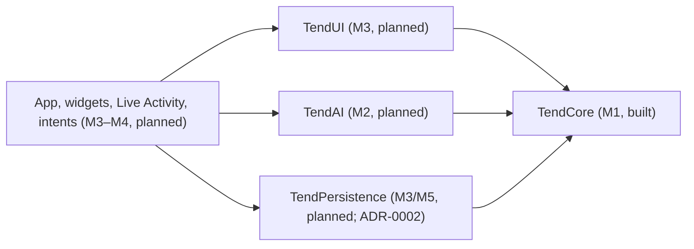

# Architecture

- Start with the [TendCore architecture overview](overview.md): module map, injected inputs, and how UX-2 and UX-3
  are enforced in the engine (M1).
- Architecture Decision Records (MADR-style) live in [`adr/`](adr/). Copy `0000-template.md`, number sequentially.
- Index of ADRs is maintained by the Product Documenter below.

## Module map (current)

Text version: every later module depends on `TendCore`. `TendCore` depends only on Foundation (ADR-0001).

## ADR index

| ADR | Title | Status | Requirements | Notes |
|---|---|---|---|---|
| [0001](adr/0001-tendcore-module-boundary.md) | `TendCore` is a Foundation-only, deterministic domain package | **Accepted** (2026-11-20) | FR-B1, FR-B2, FR-B3, UX-2, UX-3, P-1, P-2; AC-M1-01, 02, 22, 23, 24 | Reviewer confirmed in the WI-M1-01 review. |
| [0002](adr/0002-app-persistence-store.md) | App persistence store with CloudKit household sharing in mind | **Proposed** | FR-B1, FR-B2, FR-E1, P-2 | Direction: Core Data + `NSPersistentCloudKitContainer`, fallback `CKSyncEngine`. Needs a macOS spike before the M3 adapter. |
| [0003](adr/0003-project-generation.md) | Xcode project generation (XcodeGen vs Tuist) | **Proposed** | CLAUDE.md §3, §6; P-2 | Direction: XcodeGen. To be accepted when the app target is created (M3). |
| [0004](adr/0004-household-json-file-format.md) | Household JSON file format, exact dates and atomic save in `TendCore` | **Proposed** | FR-B1, FR-B2, P-2; AC-M1-04…07, 25 | Reviewer agreed in the WI-M1-02 review; the Developer (ADR owner) has not moved it to Accepted. W2-F1 note added: non-file URLs are refused. |
| — (planned) | Real weather source: WeatherKit with coarse location | **Planned** (not written) | FR-B1, FR-A1, P-2, P-4; brief Q22 | Must be PO-approved before any weather source is wired (M3/M4). Covers coarse-location method, request contents, caching, Privacy Manifest and label, and `unknown` on failure or denial. |
