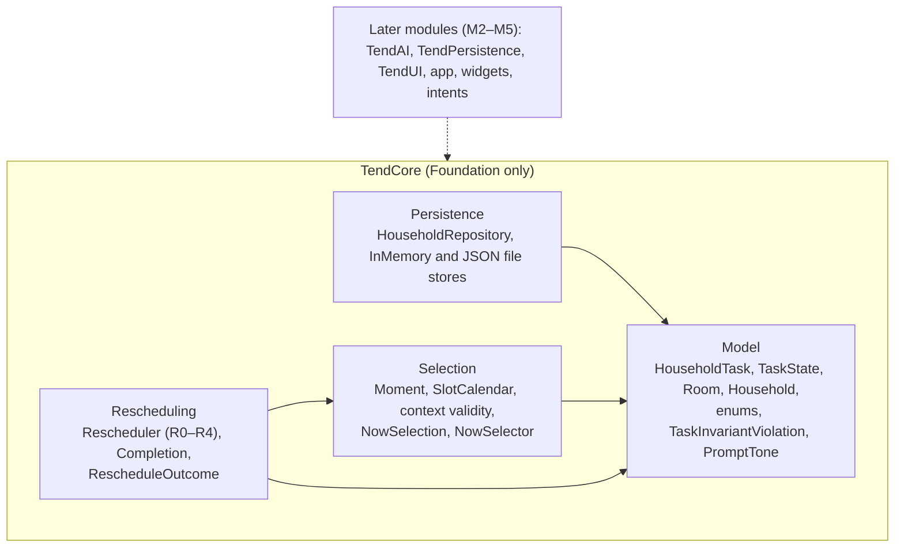

# TendCore architecture overview (M1)

- **Owner:** Product Documenter  ·  **State of the code:** `main` at `6fff92c` (M1, PRs #3, #5, #6, #7, #8)
- **Audience:** builders (future agents and engineers) and reviewers.
- **Requirements:** FR-B1, FR-B2, FR-B3 (data only), UX-2, UX-3, P-1, P-2; CLAUDE.md §3; AC-M1-01…25.
- **Decisions:** [ADR-0001](adr/0001-tendcore-module-boundary.md) (module boundary),
  [ADR-0004](adr/0004-household-json-file-format.md) (file format); product rules in
  [`docs/milestones/M1/brief.md`](../milestones/M1/brief.md) (Definitions, R0–R4, Q1–Q23) and design rules D-1…D-3 in
  [`docs/milestones/M1/design.md`](../milestones/M1/design.md).

## What TendCore is

`TendCore` is the household "brain". It is a pure Swift package at `Packages/TendCore`. It holds a household's tasks
and rooms, saves and loads them, picks **at most three** tasks that fit this moment, and moves tasks calmly when their
window ends. It has no UI and no AI.

Three rules shape everything in it (ADR-0001):

1. **Foundation only.** The only import is `import Foundation`. No networking, no Apple-only framework. A source-scan
   test enforces this on every PR (AC-M1-23).
2. **Deterministic.** The engine never reads the clock, the device calendar, the time zone, the locale, the weather or
   a random source. Every input is passed in. The same inputs always give the same output (AC-M1-22).
3. **Laws in the types.** The Rule of Three (UX-2) and Zero-Guilt (UX-3) are properties of the types and the engine
   API, not of a screen.

It builds and tests on Linux: `swift test --package-path Packages/TendCore` (Swift 6.2, Swift 6 language mode, strict
concurrency). CI runs the same with `-Xswiftc -warnings-as-errors`.

## Module map

The package has one library target with four folders. Later modules (`TendAI`, `TendPersistence`, `TendUI`, the app
and its extensions) will sit on top and depend on `TendCore`. `TendCore` depends on nothing of theirs.

Text version of the diagram: Persistence, Selection and Rescheduling all use Model. Rescheduling also uses the slot
calendar from Selection to find the next eligible window. Later modules depend on `TendCore`, never the other way.

| Folder | Files | What it does | ACs |
|---|---|---|---|
| `Model/` | `HouseholdTask`, `TaskState`, `TaskKind`, `Effort` (+ `EnergyLevel`), `Daypart`, `Weekday`, `WeatherCondition`, `Room`, `Household`, `TaskInvariantViolation`, `PromptTone` | The household data. Value types that are `Equatable`, `Hashable`, `Codable` and `Sendable`. | AC-M1-01, 02, 25 |
| `Persistence/` | `HouseholdRepository`, `InMemoryHouseholdRepository`, `JSONFileHouseholdRepository`, `HouseholdStoreError` | Keeps a household safe on the device. | AC-M1-04…07, 25 |
| `Selection/` | `Moment`, `SlotCalendar`, `ContextValidity`, `NowSelection`, `NowSelector` | Decides what fits now, and returns at most three. | AC-M1-08…16 |
| `Rescheduling/` | `Rescheduler`, `Completion`, `RescheduleOutcome` | Moves tasks whose window ended, and completes tasks. | AC-M1-03, 17…21 |

### Model

- **`HouseholdTask`** has exactly 15 stored fields: `id`, `title`, `kind`, `roomID`, `effort`, `isCritical`,
  `isDeepClean`, `isWeatherDependent`, `allowedDayparts`, `allowedWeekdays`, `windowStart`, `windowEnd`,
  `recurrenceIntervalDays`, `state`, `completedAt` (design.md naming list). There is no other stored field, and a test
  pins the field list and the encoded keys (D-2).
- **`TaskState`** is a closed set of five cases: `active`, `deferred(until:)`, `maintenance`, `resurfaced`, `completed`.
  Decoding rejects any other name; it never falls back to a default (AC-M1-02, AC-M1-25).
- **Kinds** are `oneOff`, `recurring` and `restock`. **Effort** and **energy** are `low`, `normal`, `high`.
  **Dayparts** are morning, afternoon, evening and night; the default leaves night out (Q2). **Weather** is `clear`,
  `cloudy`, `wet`, `severe` or `unknown`.
- **`Room`** has `id`, `name` and an optional `lastTendedAt` (FR-B3 data only; the Room Pulse view is M3).
- **`Household`** holds `tasks`, `rooms` and `schemaVersion` (currently `1`).
- **Invariants (AC-M1-25).** One throwing initialiser checks nine rules, and `init(from:)` uses the same check, so an
  invalid task can be neither built nor decoded: dayparts and weekdays are non-empty; `windowEnd > windowStart`; a
  recurring task has an interval of at least one day; a non-recurring task has none; a task is not both critical and
  deep clean; `maintenance` only on a deep clean; `resurfaced` only on a critical task. Errors are
  `TaskInvariantViolation` cases.
- **Read-only outside the engine.** Stored properties are `public internal(set)`. Other modules can read a task but
  cannot change it in a way that breaks an invariant (ADR-0001).
- **Helpers:** `isResting(at:)`, `isRestOver(at:)`, `windowIsOpen(at:)`, `windowHasEnded(at:)`. Windows are half-open:
  open means `windowStart ≤ now < windowEnd`; ended means `windowEnd ≤ now` (Q13). The words follow design rule D-1
  ("rest over", never "lapsed").

### Persistence

- **`HouseholdRepository`** is the only storage interface the engine and, later, the UI use. Calls: `load()`,
  `save(_:)`, `upsertTask(_:)`, `removeTask(id:)`, `updateRoom(_:)`. All are `async` and use typed throws
  (`HouseholdStoreError`).
- **Two implementations ship in M1.** Both are actors and both pass one shared contract suite (AC-M1-04):
  - `InMemoryHouseholdRepository`, for tests and previews.
  - `JSONFileHouseholdRepository`, a local JSON file (ADR-0004).
- **File format (ADR-0004).** One UTF-8 JSON object with sorted keys. Dates are numbers of seconds since
  2001-01-01, so they read back bit-exact (AC-M1-05).
- **Safe load (AC-M1-06).** No file means nothing was saved yet, so `load()` gives an empty household. A corrupt
  file, an unknown schema version or a task that breaks an invariant throws a typed error. A load never writes, so
  the file's bytes stay unchanged.
- **Safe save (AC-M1-07).** The whole household is encoded first, then written with Foundation's atomic write
  (staging file plus rename). A save that stops part-way leaves the previous household intact.
- **Local files only (P-2, review W2-F1).** `init(fileURL:)` throws `unreadableFile` for any URL that is not a local
  file URL (`https:`, `ftp:`, `data:`, a relative URL), before any read or write.
- **Not the on-device app store.** The app store for M3 and the CloudKit sharing store for M5 are the subject of
  [ADR-0002](adr/0002-app-persistence-store.md) (Proposed). They will be further implementations behind the same
  protocol.

### Selection

- **`Moment`** carries every input for one decision: `now`, `calendar`, `timeZone`, `weather`, `energy`. The injected
  time zone wins over the calendar's own zone.
- **`SlotCalendar`** (internal) turns an instant into a slot: one daypart on one local day. The night slot (22:00 to
  05:00) belongs to the day it starts. A local time that does not exist (spring-forward) moves to the next instant;
  a repeated one (fall-back) uses its first occurrence (Q11).
- **`nextEligibleWindow(from:duration:calendar:timeZone:)`** is `E(a, D)` from the brief: start at `a` if `a` is in an
  allowed slot, otherwise at the start of the next allowed slot; end at start plus `D`. It always finds a slot
  within eight days, because dayparts and weekdays are never empty (Q14).
- **Context validity** (internal, AC-M1-08…12). A task fits the moment when all of these hold:
  - its effective state is `active`, `maintenance` or `resurfaced` (a deferral whose rest is over counts as `active`);
  - its window is open;
  - `now` is in one of its allowed slots;
  - its effort matches the energy (`low` takes low only, `normal` takes low and normal, `high` takes all; a task in
    `maintenance` counts as low, Q1, Q5);
  - if it depends on weather, the weather is `clear` or `cloudy` (Q3).

  A task whose window has ended does not fit. The selector never moves it; the caller runs the rescheduler first (Q13).
- **`NowSelector.select(from:in:)`** is the only public "what should I do now" API. It returns a `NowSelection`.
  Ranking is a fixed key with no randomness (AC-M1-16, Q7): `resurfaced` first, then earlier `windowEnd`, then
  critical before non-critical, then ascending `id.uuidString`.
- **`NowSelection`** holds 0 to 3 tasks (see "How UX-2 is enforced").

### Rescheduling

- **`Rescheduler.reschedule(_:at:calendar:timeZone:)`** runs one pass over a household (or one task, returning a
  `RescheduleOutcome` code). The rules apply in this order (brief R0–R4):

  | Rule | When | Result | Outcome code |
  |---|---|---|---|
  | R0 | Completed, or resting (`deferred(until: u)` with `u > now`) | Unchanged, even if the window ended | `unchanged` |
  | R1 | Deferral whose rest is over (`u ≤ now`) | Becomes `active`; R2–R4 then apply if the window ended | `restEnded` |
  | R2 | Window ended, deep clean | `maintenance` on `E(now, D)` | `lightened` |
  | R3 | Window ended, critical | `resurfaced` on `E(now, D)` | `broughtBackGently` |
  | R4 | Window ended, any other task | Stays `active`, on `E(now, D)` | `movedToNextWindow` |

  `D` is the task's own window length, so a window never shrinks or grows. In R2–R4 only the state and the window
  change. A second pass at the same `now` changes nothing (AC-M1-21 (e)).
- **`Household.complete(_:at:calendar:timeZone:)`** completes one task (AC-M1-03). A one-off or restock task becomes
  `completed` with `completedAt == now`. A recurring task becomes `active` on `E(now + interval days, D)`, keeping
  the same local wall-clock time. The task's room gets `lastTendedAt == now`.
- **`HouseholdTask.promptTone`** is always `.gentle`. It is computed, not stored, so it can never rise or change
  between passes (AC-M1-18). `PromptTone` has exactly one case.

## Injected inputs

| Input | Type | Where it enters | Never read from |
|---|---|---|---|
| Current instant | `Date` (`now`) | `Moment.now`; `at:` on `reschedule` and `complete`; `at:` on the state helpers | `Date()`, `Date.now`, any system clock |
| Calendar | `Calendar` | `Moment.calendar`; `calendar:` arguments | `Calendar.current` |
| Time zone | `TimeZone` | `Moment.timeZone`; `timeZone:` arguments | `TimeZone.current` |
| Weather | `WeatherCondition` | `Moment.weather` (`unknown` when none is known) | any weather service |
| Energy | `EnergyLevel` | `Moment.energy` | — |
| Task and room IDs | `UUID` | the caller passes them in | `UUID()` |
| Randomness | — | M1 uses none in selection or rescheduling (AC-M1-22) | `SystemRandomNumberGenerator`, `.random(` without `using:` |

The "never read from" column is enforced by the AC-M1-23 source scan (closed list, with negative and positive
self-tests). The Acceptance Tester also checked the compiled object files: they reference no clock, random or network
symbol (acceptance.md, charter C-4).

**Weather.** The engine only receives weather. It never fetches it. The human owner allows a real source later
(WeatherKit, coarse location only, no household data in the request), but only after a PO-approved ADR. That ADR and
the wiring are planned for M3/M4 (brief Q22). With no weather, the value is `unknown`, which already keeps
weather-dependent tasks out (Q3).

## How UX-2 (Rule of Three) is enforced in the engine

- **By the type.** `NowSelection` has exactly three private optional storage slots (`first`, `second`, `third`). A
  fourth task has nowhere to go. Its only public initialiser, `init?(items:)`, returns `nil` for four or more tasks,
  or for the same task twice. `NowSelection.capacity` is `3` (AC-M1-13).
- **By the API.** `NowSelector.select` is the only public "what to do now" call, and it returns `NowSelection`. The
  validity check and candidate lists are `internal`. There is no public `allValidTasks`, `queue`, `backlog` or
  similar (design.md, "Rule of Three bypass").
- **By proof.** Property tests over 1,000 seeded households of 50–500 tasks check that every selection has at most 3
  items, no duplicates, and that each item passes an independent oracle (AC-M1-14). The count is always
  `min(3, valid tasks)`: never padded, never empty when something fits (AC-M1-15). The order is exact (AC-M1-16).
- **What later surfaces must do.** Render a `NowSelection` as is. Never join, page or fetch more (design.md).

## How UX-3 (Zero-Guilt) is enforced in the engine

- **No debt state.** The lifecycle is the closed five-case set above. No state in it records or names lateness. A task whose window
  ended is moved, lightened (`maintenance`) or brought back gently (`resurfaced`) (AC-M1-02, AC-M1-17…19).
- **Nothing keeps score.** No counter, no original window, no history of moves, no score that grows with time
  (design rules D-2 and D-3). Tests pin the exact stored fields and encoded keys of `HouseholdTask`, `Room` and
  `Household`. `completedAt` is the latest completion only.
- **Nothing grows.** After 60 consecutive ended windows, a task's decoded structure equals its structure after one
  pass; only `windowStart` and `windowEnd` differ, and the window length stays bit-identical (AC-M1-20, with Q21 for
  the one `Date` rounding case at a power-of-two edge).
- **Calm vocabulary.** A source scan splits every identifier and string literal in `Sources/` into whole words. It
  fails on any of nine banned words (the UX-3 list plus *lateness*, *debt* and *streak*), and a self-test proves it
  catches planted words (AC-M1-02). Reason codes read calmly: `restEnded`, `lightened`, `broughtBackGently`,
  `movedToNextWindow`. Error codes avoid blame (`writeUnsuccessful`).
- **Calm prompts.** The only prompt metadata is `promptTone`, fixed at `.gentle` (AC-M1-18). There is no urgency or
  severity field.
- **Quiet nights.** The default allowed dayparts leave out night (Q2).
- **No copy in the engine.** `TendCore` emits codes only. User-facing words come in M3 from a String Catalog, under
  the tone rules in design.md.

## What was verified where

| Where | What |
|---|---|
| Linux container (Swift 6.2.4) | Full suite: 127 tests in 17 suites pass, 0 warnings (acceptance.md RUN-L). Offline run with no network (PROBE). |
| Linux CI (`swift:6.2-noble`, push on `main` at `6fff92c`) | Same: 127 tests in 17 suites, 0 warnings, `-warnings-as-errors` (acceptance.md RUN-CI, run 44824227807). |
| macOS / Darwin Foundation | **Not yet.** Calendar and DST edge cases, JSON number formatting and atomic write are proven on Linux only. Rerun in the M3 macOS lane (ticket W3-F1). |
| Simulator / device | Not applicable in M1 (no app target). |

## Known limits (carried tickets)

These are tracked in [`docs/milestones/M1/acceptance.md`](../milestones/M1/acceptance.md) ("Open tickets carried
forward"). None blocks M1.

- W3-F1: Darwin rerun of the calendar and DST tests (M3).
- W2-F2: `load()` treats any `stat` failure as "no file", which gives an empty household for unreadable storage
  (before the file store ships, M3).
- W2-F3: the two stores disagree on non-finite dates (M2/M3).
- W2-F4: protection class and durability if the JSON store ever ships on device (M3).
- W3-F4: `NowSelection.init?(items:)` is public, so a caller can wrap up to three tasks of its own choice. The cap
  still holds (M3).
- W3-F6: duplicate task IDs have no defined meaning (M2 parser, M5 sync).
- R4-F8: two unusual source forms inside `append(` escape the `contentsOf:` scan rule (next scanner change, M2).
